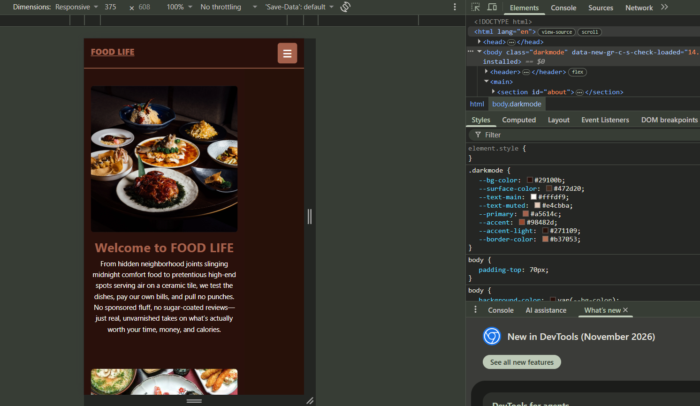
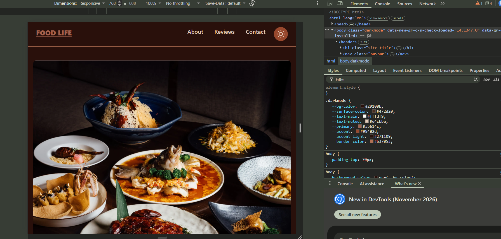
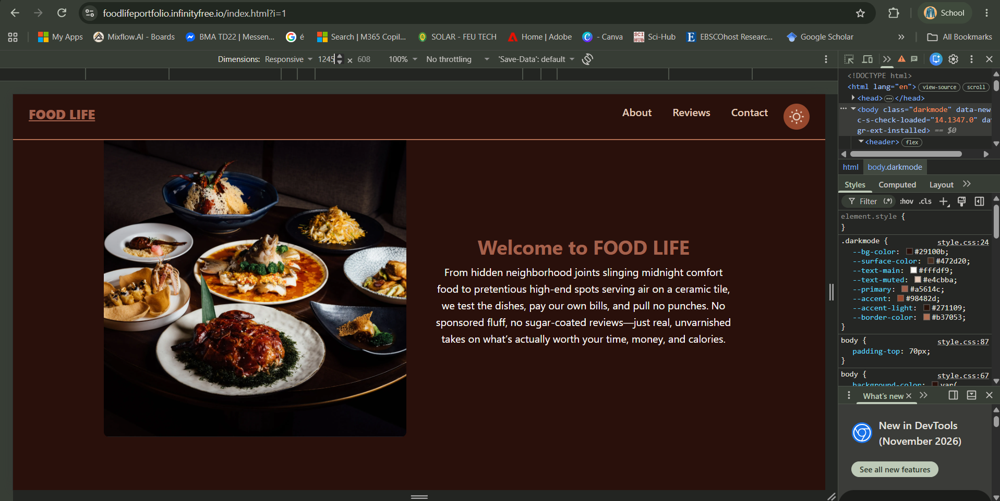

# FOOD LIFE

## Overview

I created FOOD LIFE as a food-review website for people who enjoy restaurant reviews and food recommendations. I included sample restaurant reviews, ratings, food images, and a contact form.

## Features

- I added an About section.
- I added a restaurant review table.
- I added light and dark mode.
- I added a mobile navigation menu.
- I added contact-form validation.
- I created a responsive layout for mobile, tablet, and desktop screens.

## Technologies

- HTML
- CSS
- JavaScript
- Local Storage
- InfinityFree hosting

I used Local Storage to save the selected light or dark theme.

## Setup

1. I downloaded or cloned the project.
2. I opened the project folder.
3. I opened `index.html` in a browser or used Live Server.
4. I kept `index.html`, `script.js`, the `CSS` folder, and the `assets` folder together.

## Live Demo URL

[FOOD LIFE Live Website](https://foodlifeportfolio.infinityfree.io/index.html)

## Screenshots

 - 375px mobile
 - 768px tablet
 - 1440px desktop

## Credits

I used food images for educational purposes. I did not record their original sources when I created the project.

I used inline SVG icons and system fonts in the website.

## Known Limitations

The contact form validates the entered information and displays a success message, but it does not actually send messages.

The direct `/index.html` URL loads the website correctly. The root URL may display InfinityFree’s default page.

## AI Use

I used AI to create a deployment checklist, review my README, provide deployment guidance, and help identify the live dark-mode background issue. I tested the AI suggestions myself and corrected the problems I found. I also tested the final website locally and on InfinityFree at 375px, 768px, and 1440px.
